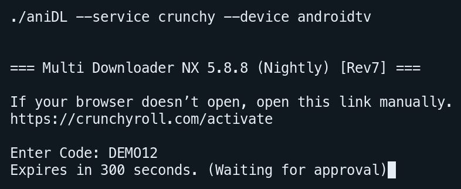
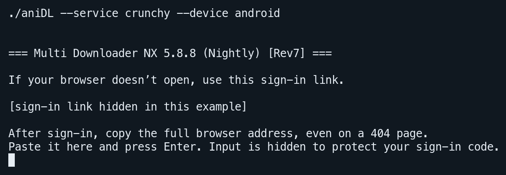
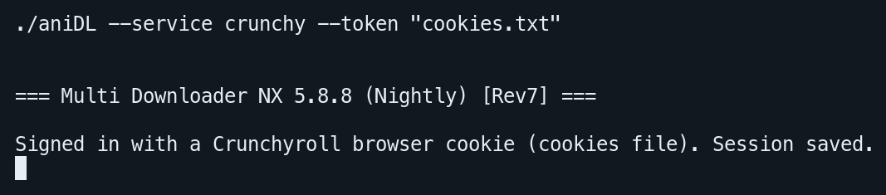

# 🔑 Sign in to a service

[🚀 Getting started](GET-STARTED.md) · [📺 Crunchyroll](#crunchyroll) · [🔐 HIDIVE and ADN](#hidive-and-adn)

Open a terminal in your extracted AniDL folder. Choose your service, then open the Windows or Linux command for your computer.

## Crunchyroll

🔄 **Previously used `--auth` for Crunchyroll?** Starting with Rev7, use `--service crunchy --device android` **(Crunchyroll only)** for phone sign-in. The old Crunchyroll command shows the sign-in options. HIDIVE and ADN still use `--auth`.

With the default settings, complete [Android TV sign-in](#android-tv) for video and [Android phone sign-in](#android-phone-or-tablet) for audio. Use the **same Crunchyroll account** both times. Both commands run on your computer.

Already have a [browser cookie](#browser-cookie), or prefer to use only one device login? Pick that method here, then use its matching video and audio options in [Getting Started](GET-STARTED.md#choose-your-sign-in).

### Android TV

Use `--device androidtv` **(Crunchyroll only)** for Android TV video or audio. Leave the terminal open while you enter the activation code in your browser.

<details>
<summary>🪟 Windows — Command Prompt</summary>

```bat
aniDL.exe --service crunchy --device androidtv
```

</details>

<details>
<summary>🐧 Linux — Terminal</summary>

```sh
./aniDL --service crunchy --device androidtv
```

</details>

[](imgs/cli/cr-login-androidtv.png)

*Example with test data. Enter the code from your own terminal on the activation page.*

1. Sign in to Crunchyroll in the browser page that opens. If it does not open, visit the activation link printed in the terminal.
2. Enter the code displayed in that terminal and approve sign-in.
3. Return to the terminal and wait for “Signed in with Android TV. Session saved.” If the code expires, run the command again to get a new one.

### Android phone or tablet

Use `--device android` **(Crunchyroll only)** for phone or tablet video or audio. If AniDL asks for phone client settings, supply both `CRUNCHYROLL_PHONE_CLIENT_ID` and `CRUNCHYROLL_PHONE_CLIENT_SECRET` in your environment or in `config/cr_phone_client.env`. The file takes one `NAME=value` per line. On Linux and macOS, only your user account may have access to it (`chmod 600 config/cr_phone_client.env`).

If you don’t have these settings, choose [Android TV](#android-tv) or [a browser cookie](#browser-cookie) and use the [matching single-login commands](GET-STARTED.md#if-you-signed-in-with-one-method).

<details>
<summary>🪟 Windows — Command Prompt</summary>

```bat
aniDL.exe --service crunchy --device android
```

</details>

<details>
<summary>🐧 Linux — Terminal</summary>

```sh
./aniDL --service crunchy --device android
```

</details>

[](imgs/cli/cr-login-android.png)

*Example with the sign-in link redacted. After sign-in, paste the full address from your own browser.*

1. Sign in to Crunchyroll in your browser. If the browser stays closed, open the sign-in link printed in the terminal.
2. After sign-in, copy the **entire address** from the browser’s address bar, even if the page says **404 – Page Not Found**. AniDL uses the address on that page.
3. Return to the same terminal, paste the address once and press **Enter**. Nothing appears while you paste because AniDL hides the address to protect its private sign-in code.
4. Wait for “Signed in with Android phone. Session saved.” If AniDL rejects the address, start the phone command again and copy the new address from that attempt.

### Browser cookie

Use `--token` **(Crunchyroll only)** for Chrome or Firefox streams. Choose **one** command below. Using a file keeps your private cookie value out of the command and your shell history.

- **Have a file?** Put `cookies.txt` in the folder where the terminal is open, or use its full path in quotes. AniDL accepts a Netscape cookies export or a plain text file containing your Crunchyroll `etp_rt` cookie value.
- **Have the value itself?** Replace `YOUR_COOKIE_VALUE` with your own `etp_rt` value.

<details>
<summary>🪟 Windows — Command Prompt</summary>

**Cookies file**

```bat
aniDL.exe --service crunchy --token "cookies.txt"
```

**Cookie value**

```bat
aniDL.exe --service crunchy --token "YOUR_COOKIE_VALUE"
```

</details>

<details>
<summary>🐧 Linux — Terminal</summary>

**Cookies file**

```sh
./aniDL --service crunchy --token "cookies.txt"
```

**Cookie value**

```sh
./aniDL --service crunchy --token "YOUR_COOKIE_VALUE"
```

</details>

[](imgs/cli/cr-login-token.png)

*Example with a test cookies file and a simulated sign-in. A successful import ends with “Session saved.”*

If AniDL cannot read the file, check the quoted path. If Crunchyroll rejects the cookie, sign in to Crunchyroll again and use a fresh cookie. Keep the cookie and the file private.

[Continue to your first Crunchyroll download](GET-STARTED.md#find-and-download-one-episode).

## HIDIVE and ADN

HIDIVE and ADN still use `--auth`. Run the command for **one** service. AniDL will ask for your username or email, then your password.

<details>
<summary>🪟 Windows — Command Prompt</summary>

**HIDIVE**

```bat
aniDL.exe --service hidive --auth
```

**ADN**

```bat
aniDL.exe --service adn --auth
```

</details>

<details>
<summary>🐧 Linux — Terminal</summary>

**HIDIVE**

```sh
./aniDL --service hidive --auth
```

**ADN**

```sh
./aniDL --service adn --auth
```

</details>

Enter your username or email at `[Q] LOGIN/EMAIL:` and your password at `[Q] PASSWORD:`. Press **Enter** after each.

[Back to the service overview](README.md#services)
